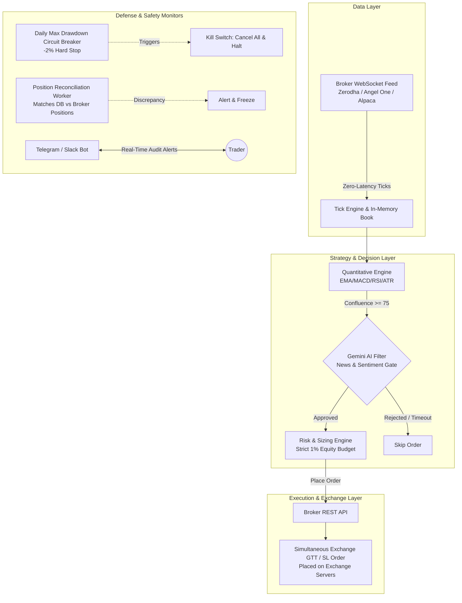
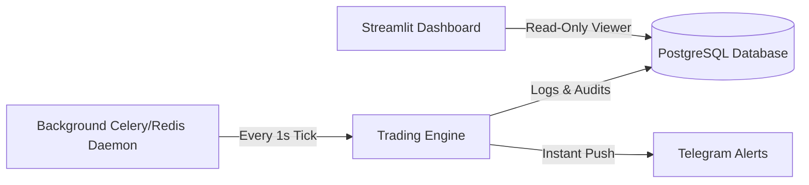

# Production-Grade Reliability & Safety Blueprint for Real-World Trading

Transitioning an automated trading system from paper simulation to live financial markets requires shifting from **prototype logic** to **defense-in-depth risk engineering**. In real trading, capital preservation always precedes profit generation.

---

---

## 1. Eliminate Data Feed Fragility (Replace Scraping with Broker WebSockets)

| Prototype Limitation | Real-World Production Requirement |
| :--- | :--- |
| Free third-party scraping (e.g., Yahoo Finance) is subject to HTTP 429 throttling, delayed quotes, and sudden schema breaks. | Direct **Level-2 WebSocket streaming** from your registered broker. |
| Polling on a web page timer (10s intervals). | Event-driven tick streaming (instant milliseconds-level updates on every trade tick). |

### Recommended Broker APIs
* **Indian Equities (NSE/BSE):**
  * **Zerodha Kite Connect:** Python SDK (`kiteconnect`), binary WebSocket streaming, sub-second latency.
  * **Angel One SmartAPI:** Free API tiers with real-time WebSocket market feeds.
  * **Upstox / Dhan HQ:** Modern Python SDKs with free developer market data feeds.
* **US Equities (NASDAQ/NYSE):**
  * **Alpaca Markets:** Free real-time paper and live trading API with WebSocket streaming.
  * **Interactive Brokers (IBKR):** Institutional-grade direct market access.

---

## 2. Exchange-Side Risk Protection (Never Rely on Software Stop-Losses)

> [!CAUTION]
> **The Software Stop-Loss Trap:**
> In paper simulation, stop-losses are evaluated in code during a tick. In live trading, if your server experiences a power cut, internet drop, or container restart during a market flash crash, a software stop-loss **will fail to execute**, leaving your position unprotected.

### The Production Standard
1. **Broker Bracket Orders / Exchange GTT Orders:**
   * When placing a BUY order with the broker API, simultaneously submit an exchange-registered Stop-Loss order (**SL-Limit** or **GTT - Good-Till-Triggered**).
   * Even if your trading bot server shuts down entirely, the exchange matching engine (NSE/NASDAQ) itself will automatically execute the stop-loss order if price drops.
2. **Account-Level Daily Circuit Breaker:**
   * Hardcode a daily max account loss limit (e.g., **-2.0% of total account capital**).
   * If realized + unrealized daily losses exceed 2%, the system immediately triggers the emergency kill-switch: closes all open positions, cancels all pending orders, and locks the bot for the remainder of the trading day.
3. **Sector & Asset Concentration Limits:**
   * Never hold more than 2 stocks from the same industry sector (e.g., max 1 Banking, max 1 IT).
   * Cap single-position capital allocation to a maximum of 20% of total portfolio equity.

---

## 3. Decouple Architecture: Background Daemon Instead of Browser Polling

Currently, the trading cycle runs when your Streamlit browser window refreshes. For production, the trading system must be an autonomous, detached server process.

* **Independent Background Daemon:**
  Run the trading engine as a system service (e.g., using `systemd` or a dedicated Docker worker with Redis task queues). It runs 24/7 without needing any browser tab open.
* **Position Reconciliation Worker:**
  Every 60 seconds, an automated background job calls `broker.positions()` and matches it against your internal database. If there is even a 1-share difference, trading is paused and an alert is sent.
* **Pre-Flight Sanity Checks (09:00 AM IST / 09:15 AM ET):**
  Before market opens, the engine runs an automated check:
  1. Verify broker API authentication token is fresh and valid.
  2. Verify exchange holiday calendar.
  3. Verify available cash margin with the broker.
  4. Test WebSocket connectivity.

---

## 4. AI Guardrails: Quantitative Math Always Overrules LLMs

> [!IMPORTANT]
> **LLM Safety Principle:** Large Language Models (LLMs) should **never** generate raw buy/sell price targets directly. They must act strictly as a **qualitative second opinion / veto filter**.

1. **Math First:** High-probability confluence must first be proven deterministically by technical indicators (EMA alignment, MACD crossover, RSI bounds, ATR volatility bands).
2. **LLM as Veto:** Gemini AI is sent a structured market snapshot and news summary to check for red flags (e.g., earnings announcements, regulatory penalties, geopolitical shocks).
3. **Fail-Safe Timeout:** If the AI API takes more than 2.0 seconds to respond or throws a network timeout, the system defaults to **SAFE SKIP** (does not buy).

---

## 5. Instant Human-in-the-Loop Monitoring (Telegram / Slack)

In live trading, you must receive instant push notifications for:
* **Order Placed / Filled:** Symbol, quantity, executed price, and exchange order ID.
* **Stop-Loss / Take-Profit Triggered:** Net realized P&L and charges breakdown.
* **Daily Summary at Market Close (15:30 IST / 16:00 ET):** Total trades, net return, current equity.
* **Emergency Alerts:** Network drop, unexpected rejections, or circuit breaker activation.

---

## 6. Recommended 3-Stage Phased Migration

| Stage | Capital at Risk | Duration | Objective |
| :--- | :---: | :---: | :--- |
| **Stage 1: Paper Trading on Real Broker WebSocket** | **₹0 / $0** | 2–4 Weeks | Run the bot using the official broker API in paper/mock mode. Validate zero disconnects, zero order rejections, and test edge cases. |
| **Stage 2: Micro-Lot Live Pilot** | **₹5,000 – ₹10,000** ($100–$250) | 2–4 Weeks | Trade minimal lot sizes (1 share of ITC, 1 share of Reliance) with real broker credentials. Test real exchange fees, STT, and slippage. |
| **Stage 3: Scaled Production** | **Full Target Allocation** | Ongoing | Gradually scale position sizing while maintaining the 1% per-trade risk constraint. |
